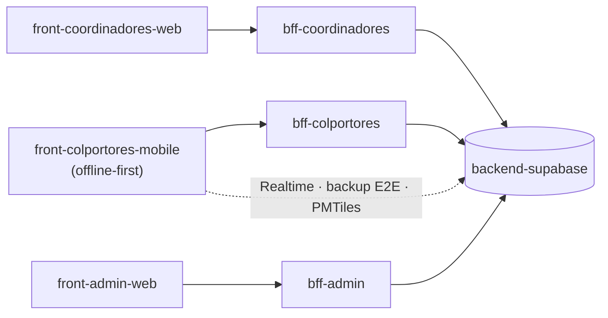

# Colportaje App

Sistema de gestión de colportaje para la **Unión Uruguaya de la Iglesia Adventista del Séptimo Día**: relevamiento del territorio, visitas, ventas, cobranzas y seguimiento de equipos.

Arquitectura híbrida local/cloud: los datos personales de los clientes viven **solo en el dispositivo del colportor** y nunca llegan al backend, conforme a la Ley 18.331 de Uruguay. El cloud recibe únicamente estado de ubicaciones, catálogos y datos no-PII.

## Aplicaciones por usuario

Cada rol tiene su propia aplicación (un frontend) servida por su propio BFF ([ADR-016](https://github.com/Colportores/docs-organizacion/blob/main/docs/decisiones/ADR-016-bff-por-aplicacion.md)). Todas se apoyan en la [base compartida](#base-compartida).

### Colportores — visitar y vender

App móvil **offline-first**: mapa con tiles descargados, registro de ubicaciones y visitas, ventas, cobranzas y jornada de trabajo. Funciona sin conexión y sincroniza cuando la hay ([ADR-006](https://github.com/Colportores/docs-organizacion/blob/main/docs/decisiones/ADR-006-arquitectura-sync.md)).

| Repositorio | Rol | Stack |
|---|---|---|
| [front-colportores-mobile](https://github.com/Colportores/front-colportores-mobile) | App móvil del colportor *(en construcción)* | Flutter · Drift + SQLCipher · Riverpod · flutter_map |
| [bff-colportores](https://github.com/Colportores/bff-colportores) | BFF de la app móvil: lotes de sync, catálogos, estado de ubicaciones *(en construcción)* | Cloudflare Workers |

Mantiene tres caminos que **no** pasan por su BFF: suscripciones de Supabase Realtime, backup incremental cifrado extremo a extremo en Google Drive ([ADR-003](https://github.com/Colportores/docs-organizacion/blob/main/docs/decisiones/ADR-003-backup-y-cifrado.md)) y descarga de tiles PMTiles ([ADR-004](https://github.com/Colportores/docs-organizacion/blob/main/docs/decisiones/ADR-004-osm-offline.md)).

### Coordinadores — seguir equipos

Panel web del coordinador: estado de sus equipos, asignación de zonas, control de jornadas y reportes de su asociación. Trabaja con agregados; **no recibe ni muestra datos de clientes**.

| Repositorio | Rol | Stack |
|---|---|---|
| [front-coordinadores-web](https://github.com/Colportores/front-coordinadores-web) | Panel del coordinador *(en construcción)* | Next.js 14 · React + TypeScript · Shadcn/ui |
| [bff-coordinadores](https://github.com/Colportores/bff-coordinadores) | BFF del panel de coordinadores *(en construcción)* | Cloudflare Workers |

### Administración — gestionar

Panel web: catálogo de productos, usuarios y roles, estructura territorial (unión / asociación / distrito) y reportes globales.

| Repositorio | Rol | Stack |
|---|---|---|
| [front-admin-web](https://github.com/Colportores/front-admin-web) | Panel de administración *(en construcción)* | Next.js 14 · React + TypeScript · Shadcn/ui |
| [bff-admin](https://github.com/Colportores/bff-admin) | BFF del panel de administración *(en construcción)* | Cloudflare Workers |

## Base compartida

Piezas que sirven a todas las aplicaciones.

| Repositorio | Rol | Stack |
|---|---|---|
| [backend-supabase](https://github.com/Colportores/backend-supabase) | Base de datos, auth, realtime y RPCs de dominio *(en construcción)* | Supabase (Postgres + PostgREST + GoTrue), región sa-east-1 |
| [docs-organizacion](https://github.com/Colportores/docs-organizacion) | Documentación de arquitectura y decisiones *(privado, interno)* | Markdown + Mermaid |
| [.github](https://github.com/Colportores/.github) | Perfil de la organización | Markdown |

Los nombres siguen `capa-usuario[-plataforma]` ([ADR-015](https://github.com/Colportores/docs-organizacion/blob/main/docs/decisiones/ADR-015-nomenclatura-repositorios.md)): la **capa** (`front` · `bff` · `backend`), el **rol que usa la aplicación** en plural (`colportores`, `coordinadores`; `admin` queda invariable) y, solo en los fronts, la **plataforma**. Los BFF no llevan plataforma: sirven a su aplicación en cualquiera. Plataformas futuras de las mismas apps (p. ej. `front-colportores-web`) serán repos front nuevos sobre el mismo BFF.

## Cómo se conecta

Cada aplicación habla **solo con su BFF**. El BFF es un adaptador sin estado que valida el JWT del usuario y lo reenvía a RPCs o vistas de Postgres: **la autoridad de permisos es la RLS**, no el BFF.

## Documentación

La documentación **transversal** (arquitectura arc42, decisiones, modelo de datos y convenciones) vive en [docs-organizacion](https://github.com/Colportores/docs-organizacion) *(privado, interno)*. La documentación **técnica de cada repo** (cómo correrlo, su esquema, sus endpoints) vive en el `docs/` de ese repo.

Puntos de entrada:

- [Estrategia de solución](https://github.com/Colportores/docs-organizacion/blob/main/docs/04-estrategia-solucion.md) — cómo se conectan las piezas.
- [Decisiones (ADRs)](https://github.com/Colportores/docs-organizacion/blob/main/docs/09-decisiones.md) — por qué el sistema es así.
- [Esquema de datos](https://github.com/Colportores/docs-organizacion/blob/main/docs/esquema-datos.md) — el modelo lógico.
- [Convenciones de desarrollo](https://github.com/Colportores/docs-organizacion/blob/main/docs/convenciones-desarrollo.md) — repos, ramas, commits, naming, tests y logs.

## Ramas

`feature/* → develop → staging → production`, siempre vía Pull Request. `production` es la rama default de los repos de código; `main` en los de documentación. Las reglas están aplicadas como rulesets de GitHub en cada repo público — ver [convenciones §3](https://github.com/Colportores/docs-organizacion/blob/main/docs/convenciones-desarrollo.md#3-branches).
