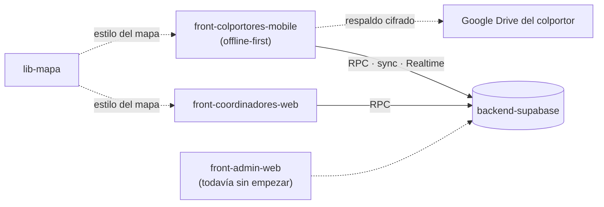

# Colportaje App

Sistema de gestión de colportaje para la **Unión Uruguaya de la Iglesia Adventista del Séptimo Día**: relevamiento del territorio, visitas, ventas, cobranzas y seguimiento de equipos.

Arquitectura híbrida local/cloud: los datos personales de los clientes viven **solo en el dispositivo del colportor** y nunca llegan al backend, conforme a la Ley 18.331 de Uruguay. El cloud recibe únicamente estado de ubicaciones, catálogos y datos no-PII.

> **¿Usás la app o el panel?** El [manual de usuario](https://colportores.github.io/manual-de-usuario/) explica cada tarea paso a paso y con capturas.

## Repositorios

### Documentación

| Repositorio | Qué es | Formato |
|---|---|---|
| [manual-de-usuario](https://github.com/Colportores/manual-de-usuario) | Manual de usuario de la app del colportor y del panel del coordinador. Se lee en [colportores.github.io/manual-de-usuario](https://colportores.github.io/manual-de-usuario/) | Sitio estático generado desde Markdown |
| [docs-organizacion](https://github.com/Colportores/docs-organizacion) | Documentación de arquitectura, decisiones, modelo de datos y plan de desarrollo *(privado, interno)* | Markdown + Mermaid |

### Aplicaciones

Cada rol tiene su propia aplicación.

| Repositorio | Qué es | Stack |
|---|---|---|
| [front-colportores-mobile](https://github.com/Colportores/front-colportores-mobile) | App móvil del colportor, **offline-first**: mapa con tiles descargados, casas y visitas, ventas, cobranzas y jornada de trabajo. Funciona sin conexión y sincroniza cuando la hay *(en construcción)* | Flutter · Drift + SQLCipher · Riverpod · MapLibre |
| [front-coordinadores-web](https://github.com/Colportores/front-coordinadores-web) | Panel web del coordinador: estado de sus equipos, ciudades y zonas, control de jornadas y reportes. Trabaja con agregados; **no recibe ni muestra datos de clientes** *(en construcción)* | Next.js · React + TypeScript · shadcn/ui · MapLibre |
| [front-admin-web](https://github.com/Colportores/front-admin-web) | Panel web de administración: catálogo de productos, usuarios y roles, estructura territorial y reportes globales *(todavía sin empezar)* | Next.js · React + TypeScript · shadcn/ui |

### Backend y librería compartida

Piezas que sirven a todas las aplicaciones.

| Repositorio | Qué es | Stack |
|---|---|---|
| [backend-supabase](https://github.com/Colportores/backend-supabase) | Base de datos, auth, realtime, RPCs de dominio y publicación de los mapas *(en construcción)* | Supabase (Postgres + PostGIS, Auth, Realtime, Edge Functions), región sa-east-1 |
| [lib-mapa](https://github.com/Colportores/lib-mapa) | Librería compartida del mapa: el estilo MapLibre con los números de puerta de OpenStreetMap, los glifos, los sprites y los colores de zonas y estados de casa, para que la app y el panel dibujen el mismo mapa *(nueva, en construcción)* | Node · salidas en Dart y TypeScript |

### Para más adelante: un BFF por aplicación

El diseño prevé un BFF (*backend for frontend*) por aplicación. **Todavía no están implementados**: se difirieron por tiempo, no se descartaron ([ADR-013](https://github.com/Colportores/docs-organizacion/blob/main/docs/decisiones/ADR-013-clientes-directo-a-rpc-de-supabase.md)). Hoy ninguna aplicación pasa por ellos y ninguno está desplegado.

| Repositorio | Qué va a ser | Estado |
|---|---|---|
| [bff-colportores](https://github.com/Colportores/bff-colportores) | BFF de la app móvil | Implementación futura |
| [bff-coordinadores](https://github.com/Colportores/bff-coordinadores) | BFF del panel de coordinadores | Implementación futura |
| [bff-admin](https://github.com/Colportores/bff-admin) | BFF del panel de administración | Implementación futura |

## Cómo se conecta

Las aplicaciones hablan **directo con Supabase**: cada lectura y cada escritura es una llamada a una función de Postgres (RPC) con el JWT del usuario. **La autoridad de permisos es la RLS** de la base ([ADR-012](https://github.com/Colportores/docs-organizacion/blob/main/docs/decisiones/ADR-012-backend-supabase-sa-east-1.md), [ADR-013](https://github.com/Colportores/docs-organizacion/blob/main/docs/decisiones/ADR-013-clientes-directo-a-rpc-de-supabase.md)).

La app móvil trabaja sobre su base local cifrada y sincroniza por lotes cuando hay conexión ([ADR-007](https://github.com/Colportores/docs-organizacion/blob/main/docs/decisiones/ADR-007-sync-batch-reactivo-y-realtime.md)). Además respalda sus datos, cifrados de extremo a extremo, en el Google Drive del propio colportor ([ADR-006](https://github.com/Colportores/docs-organizacion/blob/main/docs/decisiones/ADR-006-cifrado-db-local-y-backup-e2e-en-drive.md)) y descarga los mapas para usarlos sin conexión ([ADR-011](https://github.com/Colportores/docs-organizacion/blob/main/docs/decisiones/ADR-011-mapas-osm-pmtiles-offline.md)).

## Documentación

- **Para quien usa el sistema:** el [manual de usuario](https://colportores.github.io/manual-de-usuario/), con el [manual del colportor](https://colportores.github.io/manual-de-usuario/colportor.html), el [manual del coordinador](https://colportores.github.io/manual-de-usuario/coordinador.html), los [problemas frecuentes](https://colportores.github.io/manual-de-usuario/problemas-frecuentes.html) y el [glosario](https://colportores.github.io/manual-de-usuario/glosario.html).
- **Para quien lo desarrolla:** la documentación **transversal** (arquitectura arc42, decisiones, modelo de datos y convenciones) vive en [docs-organizacion](https://github.com/Colportores/docs-organizacion) *(privado, interno)*. La documentación **técnica de cada repo** (cómo correrlo, su esquema, sus funciones) vive en el `docs/` de ese repo.

Puntos de entrada de la documentación interna:

- [Estrategia de solución](https://github.com/Colportores/docs-organizacion/blob/main/docs/04-estrategia-solucion.md) — cómo se conectan las piezas.
- [Decisiones (ADRs)](https://github.com/Colportores/docs-organizacion/blob/main/docs/09-decisiones.md) — por qué el sistema es así.
- [Esquema de datos](https://github.com/Colportores/docs-organizacion/blob/main/docs/esquema-datos.md) — el modelo lógico.
- [Convenciones de desarrollo](https://github.com/Colportores/docs-organizacion/blob/main/docs/convenciones-desarrollo.md) — repos, ramas, commits, naming, tests y logs.

## Nombres y ramas

Los repos de aplicación siguen `capa-usuario[-plataforma]` ([ADR-016](https://github.com/Colportores/docs-organizacion/blob/main/docs/decisiones/ADR-016-multi-repo-capa-usuario-plataforma.md)): la **capa** (`front` · `bff` · `backend`), el **rol que usa la aplicación** en plural (`colportores`, `coordinadores`; `admin` queda invariable) y, solo en los fronts, la **plataforma**. `lib-mapa` es una librería compartida, no una capa de una aplicación.

`feature/* → develop → staging → production`, siempre vía Pull Request. `production` es la rama default de los repos de código; `main` en los de documentación. Las reglas están aplicadas como rulesets de GitHub en cada repo público — ver [convenciones §3](https://github.com/Colportores/docs-organizacion/blob/main/docs/convenciones-desarrollo.md#3-branches).
