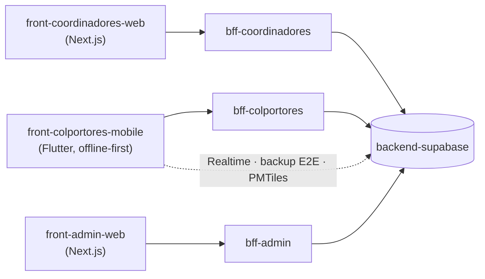

# Colportaje App

Sistema de gestión de colportaje para la **Unión Uruguaya de la Iglesia Adventista del Séptimo Día**.

Arquitectura híbrida local/cloud: los datos personales de los clientes viven **solo en el dispositivo del colportor** y nunca llegan al backend, conforme a la Ley 18.331 de Uruguay. El cloud recibe únicamente estado de ubicaciones, catálogos y datos no-PII.

## Repositorios

| Repositorio | Descripción | Stack |
|---|---|---|
| [front-colportores-mobile](https://github.com/Colportores/front-colportores-mobile) | App móvil del colportor: mapa offline, visitas, ventas y cobranzas *(en construcción)* | Flutter · Drift · SQLCipher · Riverpod |
| [bff-colportores](https://github.com/Colportores/bff-colportores) | BFF de la app móvil *(en construcción)* | Cloudflare Workers |
| [front-coordinadores-web](https://github.com/Colportores/front-coordinadores-web) | Panel del coordinador: equipos, zonas y reportes *(en construcción)* | Next.js 14 · Shadcn/ui |
| [bff-coordinadores](https://github.com/Colportores/bff-coordinadores) | BFF del panel de coordinadores *(en construcción)* | Cloudflare Workers |
| [front-admin-web](https://github.com/Colportores/front-admin-web) | Panel de administración: catálogo, usuarios y estructura territorial *(en construcción)* | Next.js 14 · Shadcn/ui |
| [bff-admin](https://github.com/Colportores/bff-admin) | BFF del panel de administración *(en construcción)* | Cloudflare Workers |
| [backend-supabase](https://github.com/Colportores/backend-supabase) | Base de datos, auth y realtime *(en construcción)* | Supabase (Postgres + PostgREST + GoTrue) |
| [docs-organizacion](https://github.com/Colportores/docs-organizacion) | Documentación de arquitectura *(privado)* | Markdown + Mermaid |

Los nombres siguen `capa-usuario[-plataforma]`: la **capa** (`front` · `bff` · `backend`), el **rol que usa la aplicación** en plural (`colportores`, `coordinadores`; `admin` invariable) y, solo en los fronts, la **plataforma** (`web` · `mobile`). Los BFF no llevan plataforma: sirven a su aplicación en cualquiera.

## Cómo se conecta

Cada aplicación habla **solo con su BFF**; el BFF es un adaptador sin estado que reenvía el JWT del usuario a Supabase. La autoridad de permisos es la RLS, no el BFF. La app móvil mantiene tres caminos directos —suscripciones Realtime, backup cifrado a Google Drive y descarga de tiles— que no pasan por ningún BFF.

## Documentación

La documentación **transversal** (arquitectura arc42, decisiones, modelo de datos, convenciones) vive en [docs-organizacion](https://github.com/Colportores/docs-organizacion), repositorio privado. La documentación **técnica de cada repo** vive en el `docs/` de ese repo.

## Ramas

`feature/* → develop → staging → production`, siempre vía Pull Request. `production` es la rama default de los repos de código.
